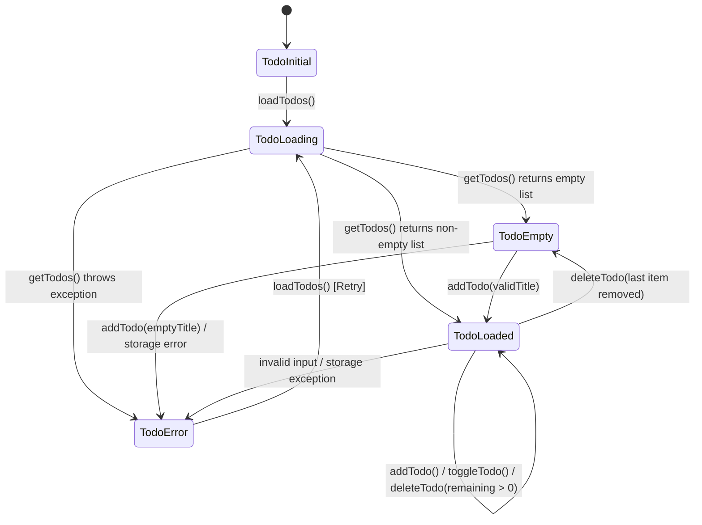

# To-Do List Application Architecture Document

## 1. Executive Summary & Overview
This application is a production-grade, minimalist To-Do List built with Flutter, adhering strictly to **Clean Architecture** principles and the **MVVM (Model-View-ViewModel)** architectural pattern implemented via **Cubit (flutter_bloc)**.

The system is designed with strict separation of concerns, high testability, zero UI business logic, and robust lifecycle handling across platforms (Windows Desktop & Android).

---

## 2. Layered Architecture (Clean Architecture)

```
lib/
├── core/                         # Shared utilities, DI, and domain-agnostic definitions
│   ├── di/
│   │   └── injection_container.dart # Service locator (GetIt) with one-line source swap
│   └── error/
│       └── failures.dart         # Standardized failure objects
├── domain/                       # Pure Dart business rules (Zero UI, Zero external SDKs)
│   ├── entities/
│   │   └── todo.dart             # Pure immutable entity extending Equatable
│   └── repositories/
│       └── todo_repository.dart  # Abstract contract for data operations
├── data/                         # Data layer (Serialization, persistent & RAM data sources)
│   ├── models/
│   │   └── todo_model.dart       # JSON serialization/deserialization extending Todo
│   └── repositories/
│       ├── in_memory_todo_repository.dart # Volatile RAM repository
│       └── local_todo_repository.dart     # SharedPreferences persistent repository
└── presentation/                 # Presentation / UI layer
    ├── cubit/
    │   ├── todo_state.dart       # Exhaustive sealed class states (Dart 3)
    │   └── todo_cubit.dart       # State management with isClosed async guards
    ├── pages/
    │   └── todo_page.dart        # Responsive Material Design 3 UI (Zero setState)
    └── widgets/
        └── todo_item_tile.dart   # Composable, reusable task tile
```

### Dependency Rule
Dependencies only point inward:
- **Presentation Layer** depends exclusively on **Domain Layer** (`Todo`, `TodoRepository`) and **Core Layer**. It has **zero awareness** of `data/` or underlying storage implementations.
- **Domain Layer** has **zero external dependencies** outside pure Dart and `Equatable`. It defines the contract (`TodoRepository`).
- **Data Layer** depends on **Domain Layer** by implementing `TodoRepository` and extending `Todo` in `TodoModel`.
- **Core Layer** encapsulates dependency injection (`GetIt`) to bind implementations to interfaces at app startup.

---

## 3. MVVM / Cubit Pattern Justification
The application leverages **Cubit** (`flutter_bloc`) as the ViewModel:
1. **Lightweight & Predictable**: Unlike full Bloc which requires event classes and event transformers, Cubit exposes explicit, type-safe methods (`loadTodos()`, `addTodo()`, `toggleTodo()`, `deleteTodo()`).
2. **Zero `setState()` Violation**: UI components remain pure `StatelessWidget`s. State mutations are managed via stream emissions, eliminating UI rebuild bugs, race conditions, and unmanaged widget lifecycles.
3. **Async Safety**: Every asynchronous operation in `TodoCubit` enforces `if (isClosed) return;` immediately following each `await`. This prevents memory leaks or calls to `emit()` on disposed Cubits.

---

## 4. State Machine & Lifecycle (Mermaid Diagram)

The state is modeled using a Dart 3 `sealed class TodoState`:
- `TodoInitial`: Initial dormant state before loading begins.
- `TodoLoading`: Data retrieval in-flight (displays spinner).
- `TodoEmpty`: Retrieval finished, list is empty (displays empty placeholder).
- `TodoLoaded`: Retrieval/mutation finished with active tasks (displays task list).
- `TodoError`: Failure occurred (displays error message with retry button and floating SnackBar).



---

## 5. Dependency Injection & One-Line Source Swap
All dependencies are registered in `lib/core/di/injection_container.dart` using `GetIt`:

```dart
// Location: lib/core/di/injection_container.dart

// ONE-LINE SOURCE SWAP:
// Uncomment the InMemoryTodoRepository line and comment out LocalTodoRepository
// to switch the entire application storage to volatile RAM-only mode.
sl.registerLazySingleton<TodoRepository>(() => LocalTodoRepository(sharedPreferences: sl()));
// sl.registerLazySingleton<TodoRepository>(() => InMemoryTodoRepository());
```

### How to Swap:
1. To use **Persistent Local Storage** (default):
   Keep `sl.registerLazySingleton<TodoRepository>(() => LocalTodoRepository(sharedPreferences: sl()));` active.
2. To use **In-Memory RAM-only Storage**:
   Comment out the `LocalTodoRepository` line and uncomment `InMemoryTodoRepository()`.
3. Because the UI and Cubit depend solely on the abstract contract `TodoRepository`, **zero lines of code in presentation/ or domain/ require changes**.

